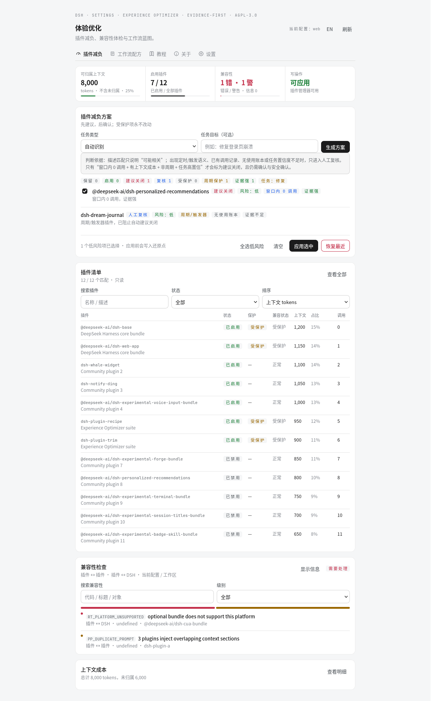
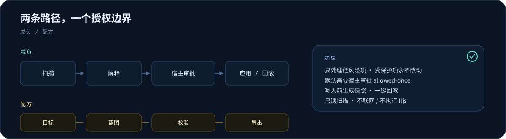

# DSH Experience Optimizer

<p align="center"><strong>English</strong> · <a href="README.md">简体中文</a></p>


<p align="center">
  <a href="https://github.com/Starlit-Sky-code/dsh-experience-optimizer/actions/workflows/ci.yml"></a>
  <a href="https://www.npmjs.com/package/dsh-plugin-trim"></a>
  <a href="https://www.npmjs.com/package/dsh-plugin-recipe"></a>
  <a href="LICENSE"></a>
</p>

<p align="center"><strong>Plugin diet · compatibility checks · workflow recipes</strong><br>
Install either plugin independently, or use both in one native settings console.</p>

## Install

```bash
dsh plugin --profile web add dsh-plugin-trim
dsh plugin --profile web add dsh-plugin-recipe
```

No `@version` means latest. `npm i` is the official alias of `npm install`; for a normal package install:

```bash
npm i dsh-plugin-trim dsh-plugin-recipe
```

Open **Settings → Experience Optimizer** after installing.

<details>
<summary>GitHub Release / source fallback</summary>

```bash
dsh plugin --profile web add "https://github.com/Starlit-Sky-code/dsh-experience-optimizer/releases/download/v0.3.5/dsh-plugin-trim-0.3.5.tgz"
dsh plugin --profile web add "https://github.com/Starlit-Sky-code/dsh-experience-optimizer/releases/download/v0.3.5/dsh-plugin-recipe-0.3.5.tgz"
```

</details>

## What it does



- **`dsh-plugin-trim`** scans plugin context cost and compatibility, then builds an explainable keep/enable/disable plan. Low-risk items are applied only after explicit confirmation and host approval; a restore point is written first.
- **`dsh-plugin-recipe`** turns a business goal into a validated, exportable workflow blueprint with per-step approval levels.
- **Guide / About / Settings** tabs make the first run explicit instead of hiding safety rules in documentation; About includes real project links, copyright, and clearly marked community/donation placeholders.
- **English and Chinese UI** can be switched at runtime.



## How “close candidate” is decided

A description match is only a relevance signal. It never produces a close suggestion on its own.

A plugin goes to review instead when it:

- has historical or session calls;
- has schedule/trigger semantics (for example monthly, weekly, `cron`, reminder, dream);
- has no usable usage ledger;
- has low task confidence.

A close candidate requires **zero calls in the usage window + non-zero attributable context cost + no schedule/trigger hint + high task confidence + low task match**. Even then, it is only a suggestion: confirmation and host approval are still required.

## Safety

- Read-only scanning; no `!!js`, no importing unloaded plugins, no network analysis.
- Protected, core, preset, and pinned items never change.
- `confirm: true` is a proposal marker; host approval returning `allowed-once` is the real grant.
- Rollback is also approval-gated.
- Data lives under `$DSH_HOME/experience-optimizer/` with `0700` / `0600` permissions.

## Links

- npm: <https://www.npmjs.com/package/dsh-plugin-trim> · <https://www.npmjs.com/package/dsh-plugin-recipe>
- Releases: <https://github.com/Starlit-Sky-code/dsh-experience-optimizer/releases>
- Issues: <https://github.com/Starlit-Sky-code/dsh-experience-optimizer/issues>
- Docs: [architecture](docs/architecture.md) · [compatibility](docs/compatibility.md) · [UI](docs/ui.md)

## License

[AGPL-3.0-only](LICENSE). If you modify and provide this software over a network, you must offer the corresponding source.

<p align="center"></p>
<p align="center"><sub>Copyright © 2026 Starlit Sky · AGPL-3.0-only</sub></p>
