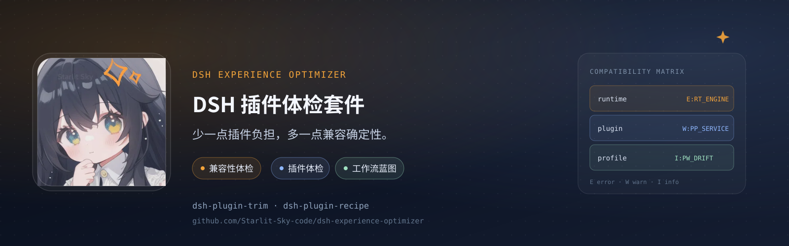

# DSH Plugin Checkup

<p align="center"><strong>English</strong> · <a href="README.md">简体中文</a> · <a href="https://starlit-sky-code.github.io/dsh-experience-optimizer/">Live site</a></p>



<p align="center">
  <a href="https://github.com/Starlit-Sky-code/dsh-experience-optimizer/actions/workflows/ci.yml"></a>
  <a href="https://www.npmjs.com/package/dsh-plugin-trim"></a>
  <a href="LICENSE"></a>
</p>

<p align="center"><strong>Plugin checkup · compatibility checks · safe trimming</strong><br>
Answers: which plugin is expensive at rest, is the compaction stack coherent, and what did an apply actually save?</p>

- **Four-check verdict**: load / compatibility / context / compaction stack, with evidence one click away.
- **Read-only compaction audit**: duplicate backends, a missing backend, and threshold conflicts are flagged; active backends are protected from disable suggestions.
- **Measured result after apply**: baseline before apply, delta settled on the next checkup after restart; unrelated changes are marked indicative.

## Not another context dashboard

| Tool | Answers | Boundary |
|---|---|---|
| `dsh-context` | What did this request/session cost in tokens, money, and cache hits? | Not responsible for per-plugin resting cost or the compaction stack. |
| `dsh-plugin-health` | Which plugin broke, and can it be repaired? | Not responsible for cost attribution or measured savings. |
| `dsh-plugin-trim` | **Which plugin is expensive at rest, is the compaction stack coherent, and what did an apply actually save?** | Does not replace them; no 0–100 health score; not a security audit. |

> Token costs are character-based estimates, not billing amounts.

## Install

```bash
# npm (pinned to this release)
npm i dsh-plugin-trim@0.5.4

# DSH CLI / plugin market:
dsh plugin --profile web add dsh-plugin-trim@0.5.4
```

> Omit `@0.5.4` to use latest; this release is `0.5.4`.
> If the plugin does not appear in Settings, reload DSH and confirm the dependency is installed in the current workspace; use the Release tarball below if npm CDN returns 404.

Open **Settings → Plugin checkup** after installing.

<details>
<summary>GitHub Release fallback</summary>

```bash
npm i "https://github.com/Starlit-Sky-code/dsh-experience-optimizer/releases/download/v0.5.4/dsh-plugin-trim-0.5.4.tgz"
```

For source development, see [Development](#development).

</details>

## What it does


<p align="center"><sub>Two-frame walkthrough: verdict → read-only compaction stack (real UI, 4-second loop).</sub></p>


- **`dsh-plugin-trim`** scans plugin context cost and compatibility, then builds an explainable keep/enable/disable plan. Low-risk items apply only after explicit confirmation; the agent tool path also asks the host by default. A restore point is written first.
- `dsh-plugin-recipe` is **temporarily deprecated**. Existing installs keep working, but no new features are planned; DSH native workflow tools cover execution.
- **Guide / About / Settings** tabs make the first run explicit instead of hiding safety rules in documentation; About includes an inline hero SVG, real links, copyright, QQ group `1134419871`, and clearly marked donation placeholders.
- Settings includes layout/density/collapse preferences, editable plugin policy fields with an Apply button that appears after changes, an npm update check, and Issue shortcuts. A first-run activation card shows the five-step tutorial after enabling; a one-time main-screen guide also points to More → Settings → Plugin checkup.
- In conversation: a brief “Measure first, then decide what to close” reminder above the composer, and a token strip in expanded reasoning. Read-only, once per session, dismissible.
- **English and Chinese UI** can be switched at runtime.


<p align="center"><sub>Read-only compaction stack: backend / pruner / image / command / threshold in one view; duplicate backends are flagged.</sub></p>


## Verdict first, details second

The settings page opens with a four-check verdict: **load**, **compatibility**,
**context**, and **compaction stack**. Each check has a status dot, a count, and
an action that scrolls to the evidence. There is deliberately no 0–100 health
score: different severities are not compressed into one scary number. Token
costs are character-based estimates, not billing amounts.

The compaction card classifies backends, tool-result pruners, image offload,
`/compact`, threshold owners, archives, and other participants. It warns on
duplicate backends, a missing backend, conflicting explicit thresholds, and
out-of-range thresholds. Active backends are protected, so the checkup never
suggests disabling the only compaction engine. The composer reminder only
interrupts when the verdict needs attention.

- **Copy report** turns the verdict, context, compaction, capability, findings,
  and measured result into Markdown for an issue or a teammate.
- **Category rollup** groups attributable tokens into core / UI / context /
  tools / workflow / integration.
- **Host baseline** shows RSS and uptime, explicitly process-level and not
  attributable to one plugin.

Unattributed context can be expanded into its top sections/tools; it never becomes a close suggestion and can be mapped through `toolOwners`.

## Did it actually save anything?

Before an apply, trim records attributable tokens and the enabled bundle/entry
set. Restart-required changes stay pending; the next checkup after restart
settles the measured delta. If unrelated plugins changed in the same window, the
delta is marked as indicative instead of claiming the whole change.

## What got more expensive since last week?

- Each checkup stores one real snapshot (throttled to 10 minutes, capped at 60).
- The context card shows a 20-point trend plus a “since last checkup” diff:
  `+N plugins / −N plugins / ±N tokens`.
- Only plugin names and token counts are stored; no prompts, section text, or tool
  arguments. `trackUsage: false` disables automatic snapshots.

## Capability surface: facts only

A read-only card lists shell, file-write, network, MCP, and `!!js` dynamic
config. It is inferred from tool names, MCP rows, and patch sentinels; it is
**not a security audit**, changes nothing, and deliberately does not produce a
security score.

## How “close candidate” is decided

A description match is only a relevance signal. It never produces a close suggestion on its own.

A plugin goes to review instead when it:

- has historical or session calls;
- has schedule/trigger semantics (for example monthly, weekly, `cron`, reminder, dream);
- has no usable usage ledger;
- has low task confidence.

A close candidate requires **zero calls in the usage window + non-zero attributable context cost + no schedule/trigger hint + high task confidence + low task match**. Even then, it is only a suggestion: confirmation and host approval are still required.

**54% is sample data, not a close target. A wrong close costs more than keeping it on.** The decision is not a keyword match: task/session use, the ledger, schedule, and cost all matter; any uncertainty goes to review. Quiet plugins that only wake up at the right moment are the easiest to close by mistake, so schedules, prior calls, or no ledger keep them protected or in review.

## Safety

- Read-only scanning; no `!!js`, no importing unloaded plugins, no network analysis.
- Protected, core, preset, and pinned items never change.
- `confirm: true` is a proposal marker; host approval returning `allowed-once` is the real grant.
- Rollback is also approval-gated.
- Data lives under `$DSH_HOME/experience-optimizer/` with `0700` / `0600` permissions.

## Development

```bash
pnpm install
pnpm typecheck
pnpm test
pnpm build
pnpm verify
```

- Design: [architecture](docs/architecture.md)
- Compatibility rules: [compatibility](docs/compatibility.md)
- UI and API: [UI](docs/ui.md)
- Marketing copy: [docs/marketing.md](docs/marketing.md)
- Promo copy: [docs/promo-copy.md](docs/promo-copy.md)

## Temporarily deprecated: workflow recipe

`dsh-plugin-recipe` is **temporarily deprecated** as of **2026-11-22**.

- Existing installs can still generate, validate, and export blueprints; security and compatibility fixes only.
- DSH native `workflow` / `dsh-tool-workflow` already cover execution; static blueprints are no longer the highest-leverage layer.
- The recipe tab is hidden when the package is not installed. When installed, it shows a **Frozen** badge and a deprecation notice.
- The npm package stays published; installing it shows a deprecation warning.
- Revival criteria are documented in [`packages/plugin-recipe/README.md`](packages/plugin-recipe/README.md).

## Links

- npm: <https://www.npmjs.com/package/dsh-plugin-trim>
- Releases: <https://github.com/Starlit-Sky-code/dsh-experience-optimizer/releases>
- Issues: <https://github.com/Starlit-Sky-code/dsh-experience-optimizer/issues>
- Docs: [architecture](docs/architecture.md) · [compatibility](docs/compatibility.md) · [UI](docs/ui.md)

## Star

If it helps you avoid a plugin conflict or see where your context budget goes, a Star is appreciated ⭐:

<https://github.com/Starlit-Sky-code/dsh-experience-optimizer>

## License

[AGPL-3.0-only](LICENSE). If you modify and provide this software over a network, you must offer the corresponding source.

<p align="center"></p>
<p align="center"><sub>Copyright © 2026 Starlit Sky · AGPL-3.0-only</sub></p>
