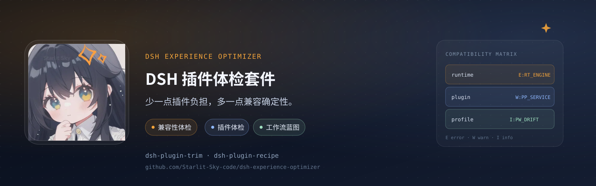
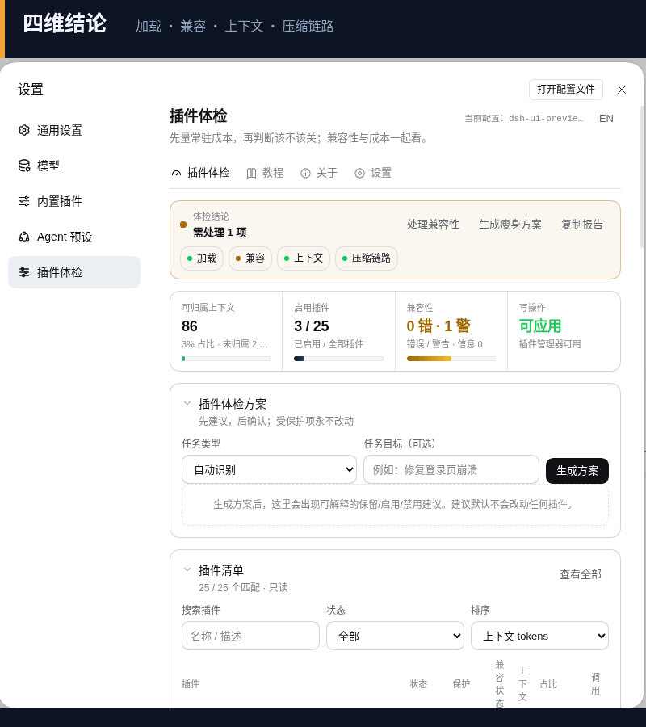
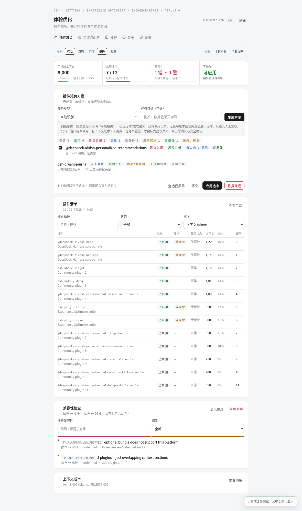
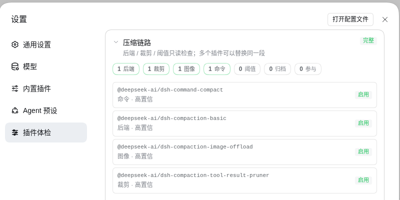
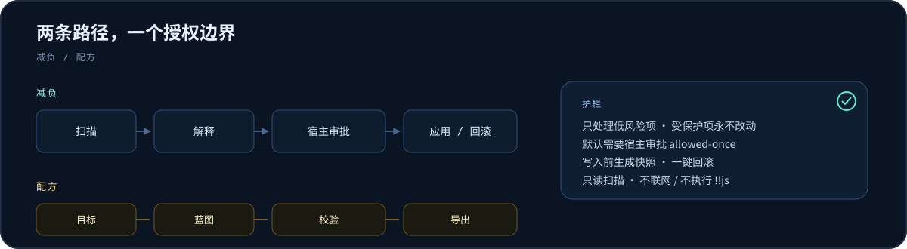

# DSH 插件体检

<p align="center"><a href="https://starlit-sky-code.github.io/dsh-experience-optimizer/">在线宣传页</a> · <a href="README.en.md">English</a> · <strong>简体中文</strong></p>



<p align="center">
  <a href="https://github.com/Starlit-Sky-code/dsh-experience-optimizer/actions/workflows/ci.yml"></a>
  <a href="https://www.npmjs.com/package/dsh-plugin-trim"></a>
  <a href="LICENSE"></a>
</p>

<p align="center"><strong>插件体检 × 兼容性检查 × 安全瘦身</strong><br>
回答“哪个插件常驻贵、压缩链路是否打架、关掉之后实测省了多少”。</p>

- **四维结论**：加载 / 兼容 / 上下文 / 压缩链路，一屏给结论与可下钻证据。
- **压缩链路只读审计**：双后端、缺后端、阈值冲突直接告警；活跃后端受保护，不会被建议关闭。
- **应用后实测收益**：应用前记录基线，重启后下一次体检结算差值；同窗口其他插件变化标“仅供参考”。

## 不是另一个上下文面板

| 工具 | 回答的问题 | 边界 |
|---|---|---|
| `dsh-context` | 这次请求/会话花了多少 token、钱和缓存命中 | 不负责插件常驻成本与压缩链路 |
| `dsh-plugin-health` | 哪个插件坏了、能不能修 | 不负责成本归属与“关掉后省多少” |
| `dsh-plugin-trim` | **哪个插件常驻贵、压缩链路是否打架、关掉之后实测省了多少** | 不替代前两者；不做 0–100 健康分，也不是安全审计 |

> token 成本按字符估算，不是账单金额。

## 安装

```bash
npm i dsh-plugin-trim
```

安装后打开 **设置 → 插件体检**（Agent 预设下方），或 **设置 → 插件 → 插件体检**。如果设置页没有出现，重新加载 DSH 并确认当前工作区已安装该依赖。

## 一眼看懂



<p align="center"><sub>两帧走查：四维结论 → 只读压缩链路（真实 UI，4 秒循环）。</sub></p>



<p align="center"><sub>设置 → 插件体检：结论、上下文、压缩链路、能力面与精简方案在同一个原生设置页里。</sub></p>



<p align="center"><sub>只读压缩链路：后端 / 裁剪 / 图像 / 命令 / 阈值一屏看清；双后端会直接标冲突。</sub></p>



## 它解决什么

DSH 插件装得越多，越容易出现三类问题：

- **上下文变贵**：插件提示词、工具描述和重复段落持续占用 token。
- **兼容性变脆**：插件↔插件、插件↔DSH 运行时、配置集/工作区之间互相冲突。
- **能力面不透明**：哪些插件能执行 shell、联网、写文件，缺少一张静态清单。

`dsh-experience-optimizer` 把这三件事放进一个套件：

| 插件 | 职责 |
|---|---|
| [`dsh-plugin-trim`](packages/plugin-trim) | 只读扫描上下文成本与兼容性，生成可解释的保留/启用/禁用建议；低风险项经用户确认后应用，Agent 工具路径默认还需宿主审批，支持快照回滚 |
| `dsh-plugin-recipe` | **暂时废弃**：原工作流配方；保留现有安装，不再新增功能 |

`dsh-shared-meta` 是私有共享包，构建时内联，不增加运行时安装负担。

## 先看结论，再看细节

打开 **设置 → 插件体检**，顶部是一条四维结论：

```text
体检结论：需处理 2 项
加载 通过 · 兼容 1 警告 · 上下文 12.4k（字符估算） · 压缩链路 1 冲突
[处理兼容性] [查看压缩链路] [生成瘦身方案]
```

- **不做 0–100 健康分**：四个不同严重度的维度不压成一个唬人的数字；用状态灯 + 计数 + 可下钻证据。
- **加载**：插件行是否真的起来、peer/运行时是否匹配。
- **兼容**：插件↔插件、插件↔DSH、Profile/工作区冲突。
- **上下文**：可归属 token（字符估算）、Top 1 owner、重复提示词；未归属可展开到具体 section/tool，避免一个 97% 的黑箱。
- **压缩链路**：只读识别压缩后端、工具结果裁剪、图像卸载、`/compact`、阈值控制面；单一后端会标出“生效后端”，多后端则明确写“未确定”，不猜测加载顺序；发现双引擎、缺失后端、阈值冲突会直接告警，并把活跃后端加入保护名单，避免体检把唯一压缩后端建议关掉。

应用后如果实测 token 反而增加，会明确标“优化后反而增加”并提供一键回滚；零变化也不会被包装成收益。对话上方只在结论需要处理时出提醒（例如“压缩链路：2 个后端同时启用”）；没事时不打扰。结论条里的“生成瘦身方案”会直接生成草稿，不再多一步滚动。草稿支持“只选强证据”、显示每项“启用 → 停用 / 禁用 → 启用”的变化，以及预计释放 token。

- **一键复制报告**：把结论、上下文、压缩链路、能力面、兼容发现和实测收益复制成 Markdown，方便贴 Issue 或发给同事。
- **按类别看构成**：核心 / 界面 / 上下文记忆 / 工具 / 工作流 / 集成，直接看哪类最贵。
- **宿主基线**：RSS 与 uptime 只作进程级参考，明确标注不可归因到单个插件。

## 关掉之后，真的省了吗？

- 应用前记录可归属 token、总 token 和启用 bundle/entry 基线。
- 需要重启的变更会保持“待结算”；重启后打开体检，自动计算**实测差值**。
- 如果同一窗口内还有其他插件变化，会标记“差值仅供参考”，不把别人的变化算成自己的收益。
- 只对比可归属 token，不拿会话增长后的总量冒充收益。

## 一周后，谁变贵了？

- 每次体检保存一条真实快照（节流 10 分钟，最多 60 条）。
- 上下文卡显示最近 20 次的迷你趋势，以及自上次体检的 `+N 插件 / −N 插件 / ±N tokens`。
- 只记插件名和 token 计数，不记对话、section 文本或工具参数；`trackUsage: false` 时不做自动快照。

## 能力面：只列事实

- shell、文件写入、网络、MCP、`!!js` 动态配置五组静态清单。
- 按工具名、MCP 行和 patch 哨兵推断；**不是安全审计**，也不改变任何插件。
- 目的是让“这个插件能做什么”可见，而不是给插件打安全分。

## “建议关闭”怎么判断？

54% 这类数字之所以扎人，是因为它把插件**常驻上下文**变成了可见的占比；但你砍的是工具白名单，真正难量的是插件本身。`trim_scan_plugins` 会读取每个 bundle 的可归属上下文成本；网页控制台的插件清单新增了 **上下文 / 占比** 两列，并单独标出 `unattributedTokens`，避免把“未归属”误算到某个插件头上。

**54% 是示例降幅，不是关闭目标；关错了比开着更贵。** 判断不是看词像不像：先看本任务/会话是否调用，再看账本、周期和成本；任一不确定只进入复核。平时不吭声、关键时刻才出手的插件最容易误关，周期/触发、已有调用、无账本都会先保护或复核。

判断顺序不是“描述像不像当前任务”这么简单：

| 信号 | 代码里怎么用 | 单独能建议关闭吗 |
|---|---|---|
| 描述 / 名称关键词 | 只计算任务相关性（`taskMatch`） | 不能，最多进入复核 |
| 历史 / 本会话调用 | 有调用记录 → 直接阻止自动建议 | 不能，反而保护 |
| 使用账本窗口内 0 调用 | 必要证据；账本为空时视为“未知” | 不能 |
| 周期 / 触发器语义 | `schedule`、`cron`、`每月`、`周报`、`提醒`、`dream` 等 → 保护 | 不能 |
| 可归属上下文成本 | 成本 > 0 才值得优化 | 不能 |
| 任务置信度 | 低于阈值 → 只复核 | 不能 |

默认 `suggestionPolicy: conservative`：只有**窗口内 0 调用 + 有上下文成本 + 非周期 + 当前任务高置信 + 描述低相关**同时成立，才会出现“建议关闭”。其余全部进入人工复核；应用仍需 `confirm: true` 与宿主审批 `allowed-once`。

这也是为什么不会因为“上次没调用”就误伤每月一次的梦整理：周期/触发器语义是硬保护，历史有调用也会阻止自动建议。

## 核心机制

### 先建议，后授权

`trim_apply_profile` 的 `confirm: true` 只是**提案标记**。默认流程是：

```text
草稿 → confirm: true → ctx.approval.request() → allowed-once → 快照 → 应用
```

- 审批缺失、抛错、`rejected`、`cancelled`、`unavailable` 一律失败即拒绝
- 审批原因带配置集、草稿 id、快照 id 和具体条目
- 只应用低风险、非受保护项；受保护/核心/预设/固定项永不改
- 失败自动回滚；回滚工具同样需要宿主审批

### 兼容性矩阵

覆盖四个域：

| 域 | 例子 |
|---|---|
| 插件 ↔ 插件 | peer 依赖缺失、提示词重复、互斥能力 |
| 插件 ↔ DSH | DSH 版本、Node/平台、官方配置行覆盖 |
| 配置集 | 多个配置集的启用差异、锁文件漂移 |
| 工作区 | `AGENTS.md`/`CLAUDE.md` 与插件规则重叠 |

### 工作流蓝图（暂时废弃）

`dsh-plugin-recipe` 自 2026-11-22 起暂时冻结，不再新增功能。现有安装仍可生成、校验和导出蓝图；DSH 原生 `workflow` 工具已覆盖执行层。详见[暂时废弃说明](#暂时废弃工作流配方)。

## 网页控制台

- **后台更新**：检查到新版本可后台下载并应用（默认手动，可勾选自动）；重启 DSH 后生效
- **上下文预算**：可设一个可归属 token 上限（默认关闭），超预算时结论转琥珀色、给出“查看上下文”动作，指标与报告显示已用比例；参数区默认折叠，悬停 ⓘ 看说明
- **简洁 / 完整视图**：默认只显示结论、问题卡、上下文与方案；插件清单、空兼容卡、诊断等收进“完整视图”
- **结论驾驶舱**：大号结论 + 四张可点击检查卡（加载/兼容/上下文/压缩）+ 主操作；点卡直达证据
- **体检与兼容**：摘要指标、兼容性搜索/级别过滤、上下文成本、插件清单搜索/筛选/排序、压缩链路、能力面、实测收益、精简方案、应用/回滚
- **教程**：5 分钟上手、按任务快速开始、常见问题
- **关于**：Hero SVG、项目链接、版本、许可证、版权、QQ 群 `1134419871`、捐赠占位
- **设置**：界面偏好（内容排列/密度/折叠）、可编辑的插件策略（改动后才出现「应用修改」）、检查更新、新建 Issue、保护名单与配置片段
- **对话内**：输入框上方短暂显示「先量成本，再决定关什么」提醒；展开 thought line 显示 token 摘要；只读、每会话一次、可关闭
- 首次启用后，插件管理器会显示 5 步教程卡；主界面左下角还有「更多 → 设置 → 插件体检」路径引导
- 同源 JSON API 校验 DSH 浏览器会话与 `Origin`；未登录返回 401
- 网页界面的应用/回滚按钮本身就是用户操作，因此不重复弹宿主审批；Agent 工具路径默认走审批

详见 [docs/ui.md](docs/ui.md)。

## 工具

| 工具 | 作用 |
|---|---|
| `trim_scan_plugins` | 只读扫描插件、上下文成本、兼容性摘要 |
| `trim_analyze_compatibility` | 只读兼容性矩阵：插件↔插件、插件↔DSH、配置集/工作区 |
| `trim_suggest_profile` | 按任务生成精简方案草稿，不修改插件 |
| `trim_apply_profile` | 提案 + 宿主审批 `allowed-once` 后应用低风险项 |
| `trim_rollback_profile` | 宿主审批后恢复上一次精简方案 |

## 暂时废弃：工作流配方

`dsh-plugin-recipe` 自 **2026-11-22** 起暂时废弃（temporarily deprecated），不再新增功能。

- 现有安装仍可生成、校验和导出蓝图；仅接收安全/兼容修复。
- DSH 原生 `workflow` / `dsh-tool-workflow` 已覆盖执行层；纯静态蓝图不再是最高杠杆。
- 未安装 recipe 时，设置页不再显示「工作流配方」页签；已安装时页签会标注「已冻结」并显示说明。
- npm 包不会被删除；安装旧版本会看到 deprecation 提示。
- 复活条件见 [`packages/plugin-recipe/README.md`](packages/plugin-recipe/README.md)。

## 市场与发布

- npm：<https://www.npmjs.com/package/dsh-plugin-trim>
- Release：<https://github.com/Starlit-Sky-code/dsh-experience-optimizer/releases>
- dshopen.org：<https://dshopen.org/zh/plugins/dsh-plugin-trim/>
- dshbase.com：<https://dshbase.com/plugins/dsh-plugin-trim/>
- dsh.so：<https://www.dsh.so/artifact/dsh-experience-optimizer/>
- DSH 自定义索引：
  ```text
  https://raw.githubusercontent.com/Starlit-Sky-code/dsh-experience-optimizer/main/marketplace/index.json
  ```

市场收录状态见 [marketplace/DISTRIBUTION.md](marketplace/DISTRIBUTION.md)。

## 开发

```bash
pnpm install
pnpm typecheck
pnpm test
pnpm build
pnpm verify
```

- 设计：[docs/architecture.md](docs/architecture.md)
- 兼容性规则：[docs/compatibility.md](docs/compatibility.md)
- 界面与 API：[docs/ui.md](docs/ui.md)
- 市场文案：[docs/marketing.md](docs/marketing.md)
- 宣传语料：[docs/promo-copy.md](docs/promo-copy.md)
- 发布状态：[marketplace/STATUS.md](marketplace/STATUS.md)

## 安全

- 默认只建议，不自动禁用。
- Web API 先经过 DSH 连接认证、同源检查和自定义 `x-dsh-trim-client` 请求头；不提供跨站 CORS。
- 兼容性分析只读本地元数据，不执行 `!!js`、不 import 未加载插件、不联网。
- 数据写入 `$DSH_HOME/experience-optimizer/`，目录 `0700`、文件 `0600`。
- 版本豁免、插件升级、patch 编辑只报告，不自动执行。

## Star

如果它帮你少踩一次插件冲突、或者看清了上下文成本，欢迎点个 Star ⭐：

<https://github.com/Starlit-Sky-code/dsh-experience-optimizer>

## 许可证

[AGPL-3.0-only](LICENSE)。修改后通过网络向用户提供服务时，需要按 AGPL 提供对应源代码。

<p align="center"></p>
<p align="center"><sub>Copyright © 2026 Starlit Sky · AGPL-3.0-only</sub></p>
