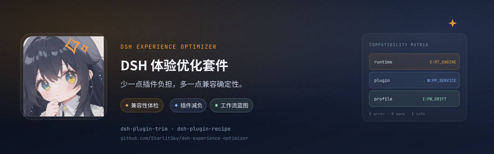

# dsh-experience-optimizer



[](https://github.com/StarlitSky/dsh-experience-optimizer/actions/workflows/ci.yml)
[](LICENSE)

> **少一点插件负担，多一点兼容确定性。**
>
> 插件减负 × 兼容性体检 × 工作流蓝图。

DSH 插件生态的**减负**、**兼容性体检**与**工作流翻译**套件。

- `dsh-plugin-trim`：扫描插件、上下文成本与兼容性冲突，按任务生成可解释的精简启用方案；显式确认后才应用，可回滚。
- `dsh-plugin-recipe`：把业务目标翻译成可校验、可导出的工作流蓝图。
- `dsh-shared-meta`：私有共享包，构建时内联进两个插件，不增加运行时安装负担。

> 本仓库目前处于代码实现阶段。详细设计见 [`docs/architecture.md`](docs/architecture.md)，
> 兼容性规则见 [`docs/compatibility.md`](docs/compatibility.md)，宣传素材与市场文案见
> [`docs/marketing.md`](docs/marketing.md)。

## 安装

发布到 npm 后：

```bash
dsh plugin --profile web add dsh-plugin-trim
dsh plugin --profile web add dsh-plugin-recipe
```

本地开发：

```bash
dsh plugin --profile web add /absolute/path/to/packages/plugin-trim
dsh plugin --profile web add /absolute/path/to/packages/plugin-recipe
```

## DSH 自定义插件市场索引

套件提供格式 1 市场索引：

```text
https://raw.githubusercontent.com/StarlitSky/dsh-experience-optimizer/main/marketplace/index.json
```

在 DSH「设置 → 插件市场」中加入该地址即可。索引生成与社区市场提交说明见
[`marketplace/README.md`](marketplace/README.md)。

## 快速开始

```bash
pnpm install
pnpm typecheck
pnpm test
pnpm build
pnpm verify
```

## 安装到 DSH profile

```bash
dsh plugin --profile web add /absolute/path/to/packages/plugin-trim
dsh plugin --profile web add /absolute/path/to/packages/plugin-recipe
```

本地开发时也可以使用 `scripts/smoke-profile.mjs` 在临时 profile 中验证 bundle 能被正确插入。

## 工具

| 工具 | 作用 |
|---|---|
| `trim_scan_plugins` | 只读扫描插件、上下文成本、兼容性摘要 |
| `trim_analyze_compatibility` | 只读兼容性矩阵：插件↔插件、插件↔DSH、Profile/工作区 |
| `trim_suggest_profile` | 按任务生成精简方案草稿，不修改插件 |
| `trim_apply_profile` | 用户显式确认后应用低风险项，返回回滚 token |
| `trim_rollback_profile` | 恢复上一次精简方案 |
| `recipe_plan_workflow` | 对话式向导，输出工作流蓝图 |
| `recipe_validate_workflow` | 校验依赖、权限、循环、兼容性 |
| `recipe_export_workflow` | 导出 Markdown/JSON 蓝图到 DSH 数据目录 |

## 安全边界

- 默认只建议，不自动禁用。
- `trim_apply_profile` 必须显式 `confirm: true`，只应用低风险项；受保护插件永不改。
- 兼容性分析只读本地元数据，不执行 `!!js`、不 import 未加载插件、不联网。
- 版本豁免与插件升级只报告，不自动执行。
- 数据写入 `$DSH_HOME/experience-optimizer/`，目录 `0700`、文件 `0600`。

## 开发

```bash
pnpm install
pnpm build        # 构建 shared-meta，再构建两个插件
pnpm test         # vitest
pnpm typecheck    # 每个包 tsc --noEmit
pnpm verify       # 构建 + 打包契约检查 + 测试
```
