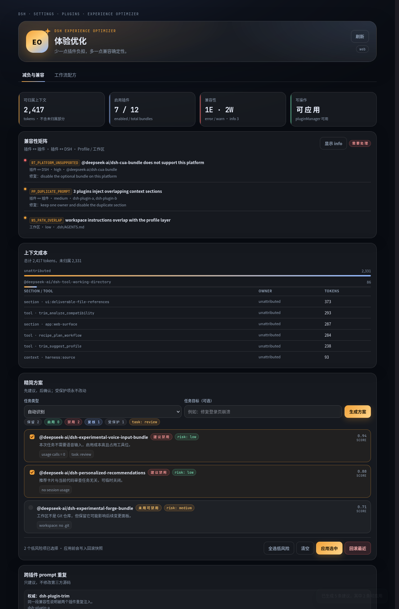

# Web 控制台

「体验优化」是 `dsh-plugin-trim` 的浏览器半身，注册在 DSH 设置的
`settings.plugins.tab` 槽位。它不替代任何工具，只是把同一套只读分析与本地草稿
能力呈现为可视化面板。



## 打开

安装 `dsh-plugin-trim` 与 `dsh-plugin-recipe` 后，有两个入口：

```text
设置 → 体验优化          # 左侧导航，Agent 预设下方，滑杆图标（order 25）
设置 → 插件 → 体验优化   # 内置插件页签
```

左侧入口由 `settings.section` + `settings.section.icon` 注册：
section id 为 `experience-optimizer`，图标是 16px 的三段滑杆 SVG。

## 页面

### 减负与兼容

- 四张指标卡：可归属上下文、启用插件数、兼容性 error/warn、写操作可用性。
- 兼容性矩阵：按 `plugin-plugin`、`plugin-runtime`、`profile`、`workspace`
  展示发现、证据与建议修复；默认隐藏 info。
- 上下文成本：按 owner / section / tool 展示 token 估算。
- 精简方案：
  - 选择任务类型（或自动识别）与可选目标；
  - 生成 keep / enable / disable / review 建议；
  - 低风险、非受保护项可勾选；
  - 确认弹窗后调用应用；显示逐项结果、回滚 token 与重启提示；
  - 「回滚最近」恢复上一次应用快照。

### 工作流配方

- 表单覆盖业务目标、范围、频率、来源、输出格式、交付、失败处理和验收标准；
- 生成后展示步骤、最小插件集、权限、失败策略、回滚、验收清单；
- 展示校验 error/warn 与蓝图不确定性；
- 可导出 Markdown + JSON 运行手册到 DSH 数据目录。

> UI 预览按内置能力目录判断工具可用性；精确的 agent-scope 校验仍以
> `recipe_plan_workflow` 工具为准。

## 架构

```text
packages/plugin-trim/
  client.js                 # 浏览器半身：__ModuleLoader__ 包装 + React 面板
  src/api.ts                # /api/dsh-experience-optimizer/*
packages/plugin-recipe/
  src/api.ts                # /api/dsh-experience-optimizer/recipe/*
packages/shared-meta/
  src/http.ts               # 同源检查、限量 JSON body、JSON 响应
```

Host 端在两个插件里分别注册同源 JSON 路由：

| 方法 | 路径 | 作用 |
|---|---|---|
| `GET` | `/api/dsh-experience-optimizer/overview` | 当前 profile 的扫描 + 兼容性 + 上下文 |
| `POST` | `/api/dsh-experience-optimizer/suggest` | 生成并保存精简草稿 |
| `POST` | `/api/dsh-experience-optimizer/apply` | 需要 `confirm: true`，应用低风险项 |
| `POST` | `/api/dsh-experience-optimizer/rollback` | 恢复最近快照 |
| `POST` | `/api/dsh-experience-optimizer/recipe/plan` | 生成并校验蓝图 |
| `POST` | `/api/dsh-experience-optimizer/recipe/export` | 导出运行手册 |

`registerTrimApi` / `registerRecipeApi` 使用 `ctx.inject(['webServer'], ...)`，
因此启动时和 HMR 重载时都能正确等待 Web 载体；存在 `webServer` 但不存在
`connection` 的嵌入式部署仍可用，路由只做同源检查。

## 安全

- 路由注册在 `/api` 下，但使用 Connection 的 `requestRejection()` 校验 DSH
  浏览器会话；未登录返回 401。
- 额外校验 `Origin` / `Sec-Fetch-Site`，拒绝跨站浏览器请求。
- 请求体限制 64 KiB；响应 `cache-control: no-store`。
- 只读接口不修改插件；`apply` 必须 `confirm: true`，只接受低风险、非受保护项。
- 受保护项包括核心 bundle、管理插件、agent preset、当前 profile 依赖、
  用户 `protect`/`pinned` 和本套件自身。
- 所有变更写入快照并返回回滚 token；失败自动回滚。

## 本地验证

```bash
pnpm typecheck
pnpm test
pnpm verify
```

界面本身可以用临时 DSH Web profile 验证：

```bash
dsh plugin --profile tmp-web add "$PWD/packages/plugin-trim"
dsh plugin --profile tmp-web add "$PWD/packages/plugin-recipe"
dsh --profile tmp-web --port 3091 --no-open
```

启动后访问打印的 token URL，进入 **设置 → 插件 → 体验优化**。
`client.js` 是 `__ModuleLoader__.load(...)` 包装的浏览器脚本，`package.json`
里的 `dsh.client` 与 `exports["./client"]` 是它被组合进页面所需的声明。

## 已知限制

- UI 是插件管理面板，不是独立应用；没有 DSH Web profile 时不加载。
- 兼容性分析以当前 profile 的只读元数据为准，不联网、不执行 `!!js`。
- 应用后部分行需要重启 DSH 才能生效，界面会显示提示。
