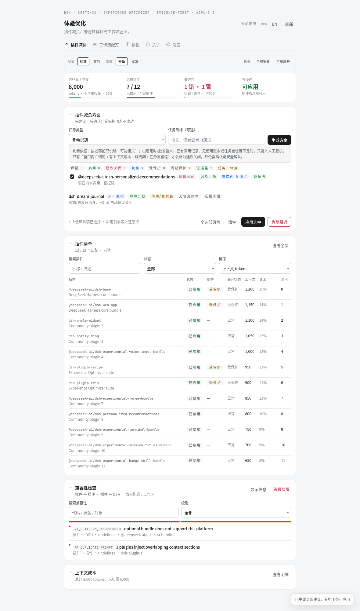

# Web 控制台

「插件体检」是 `dsh-plugin-trim` 的浏览器半身，注册在 DSH 设置的
`settings.plugins.tab` 槽位。它不替代任何工具，只是把同一套只读分析与本地草稿
能力呈现为可视化面板。



## 打开

安装 `dsh-plugin-trim` 与 `dsh-plugin-recipe` 后，有两个入口：

```text
设置 → 插件体检          # 左侧导航，Agent 预设下方，滑杆图标（order 25）
设置 → 插件 → 插件体检   # 内置插件页签
```

左侧入口由 `settings.section` + `settings.section.icon` 注册：
section id 为 `experience-optimizer`，图标是 16px 的三段滑杆 SVG。

## 页面

### 视图与折叠

- 插件清单、插件体检方案、兼容性、上下文等大卡片均可折叠；
- 顶部视图栏支持标准 / 双列、舒适 / 紧凑、全部折叠 / 全部展开；
- 偏好在浏览器 localStorage 中保存；
- 820px 以下自动单列。


### 新手引导

- 首次在浏览器打开时自动弹出 3 步引导：先量成本 → 再生成方案 → 最后安全确认；
- 支持跳过、查看完整教程、重看；
- 已读状态保存在浏览器 `localStorage`，不写入 DSH profile。

### 语言

- 顶栏 `中文 / EN` 切换；
- 默认跟随浏览器语言，持久化到 localStorage；
- 代码标识、工具名和 API 名称不翻译。

### 关于

- 项目链接、版本、License、作者、版权；
- QQ 群/捐赠方式为空时显示“待补充”，不生成假链接；
- 支持重新查看新手引导、复制安装命令。


### 教程

- 5 分钟上手：扫描 → 生成方案 → 看判断依据 → 确认应用 → 工作流配方；
- 按任务快速开始：代码审查、修复问题、整理周报；
- 常见问题：为什么没有建议关闭、周期插件保护、应用后回滚、确认与审批的区别。

### 对话内体检

- 输入框上方短暂显示「插件体检：先量成本，再决定关什么」提醒；
- 不展示统计、不复制、不写配置；每会话一次，自动消失，也可手动关闭；
- 展开的 thought line 顶部只显示当前常驻 token 数，便于在推理过程中核对成本。

### 检查更新与反馈

- 设置页提供认证的 npm 最新版本检查，不会自动升级；旧版本缺少 `/update` 时显示更新提示，而不是原始 404；
- 提供新建 Issue / 问题列表快捷入口；
- 初次启用 bundle 后由 `plugins.bundle.activation` 显示 5 步教程卡；主界面右下角还有一次性路径引导。

### 设置

- 顶部说明「修改后点击应用」；不会自动写入，应用会重载插件；
- 运行模式、审批策略、建议策略、使用账本、账本保留、草稿上限、`protect` / `pinned` 都是可编辑草稿；
- 有改动时才出现「应用修改 / 撤销」按钮，不再在顶部放刷新按钮；
- 审批阈值、账本保留、草稿上限用上下箭头微调，并在推荐区间的进度条上标记当前位置；右侧同时标注配置上限；
- 应用通过认证的 `POST /config` 写入 loader entry，审批与保护逻辑不跳过；
- 仍提供可复制的 `dsh-plugin-trim` 配置补丁，便于审阅。

### 体检与兼容

- 四张指标卡：可归属上下文、启用插件数、兼容性 error/warn、写操作可用性。
- 兼容性矩阵：按 `plugin-plugin`、`plugin-runtime`、`profile`、`workspace`
  展示发现、证据与建议修复；默认隐藏 info。
- 上下文成本：按 owner / section / tool 展示 token 估算。
- 精简方案：
  - 选择任务类型（或自动识别）与可选目标；
  - 生成 keep / enable / disable / review 建议；
  - 低风险、非受保护项可勾选；
  - 确认弹窗后调用应用；显示逐项结果、回滚 token 与重启提示；
  - 「回滚最近」恢复上一次应用快照。

### 工作流配方

- 表单覆盖业务目标、范围、频率、来源、输出格式、交付、失败处理和验收标准；
- 生成后展示步骤、最小插件集、权限、失败策略、回滚、验收清单；
- 展示校验 error/warn 与蓝图不确定性；
- 可导出 Markdown + JSON 运行手册到 DSH 数据目录。

> UI 预览按内置能力目录判断工具可用性；精确的 agent-scope 校验仍以
> `recipe_plan_workflow` 工具为准。

## 架构

```text
packages/plugin-trim/
  client.js                 # 浏览器半身：__ModuleLoader__ 包装 + React 面板
  src/api.ts                # /api/dsh-experience-optimizer/*
packages/plugin-recipe/
  src/api.ts                # /api/dsh-experience-optimizer/recipe/*
packages/shared-meta/
  src/http.ts               # 同源检查、限量 JSON body、JSON 响应
```

Host 端在两个插件里分别注册同源 JSON 路由：

| 方法 | 路径 | 作用 |
|---|---|---|
| `GET` | `/api/dsh-experience-optimizer/overview` | 当前 profile 的扫描 + 兼容性 + 上下文 |
| `POST` | `/api/dsh-experience-optimizer/suggest` | 生成并保存精简草稿 |
| `GET` | `/api/dsh-experience-optimizer/config` | 当前生效的审批/建议策略与保护名单（只读） |
| `POST` | `/api/dsh-experience-optimizer/apply` | 用户点击后应用低风险项；`confirm: true` 由 UI 提交 |
| `POST` | `/api/dsh-experience-optimizer/rollback` | 恢复最近快照 |
| `POST` | `/api/dsh-experience-optimizer/recipe/plan` | 生成并校验蓝图 |
| `POST` | `/api/dsh-experience-optimizer/recipe/export` | 导出运行手册 |

`registerTrimApi` / `registerRecipeApi` 使用 `ctx.inject(['webServer'], ...)`，
因此启动时和 HMR 重载时都能正确等待 Web 载体；存在 `webServer` 但不存在
`connection` 的嵌入式部署仍可用，路由只做同源检查。

## 安全

- Web UI 的应用/回滚按钮本身是用户点击，因此 UI API 不再重复弹宿主审批；Agent 工具路径默认先调用 `ctx.approval.request()`，只有 `allowed-once` 才执行。
- 路由注册在 `/api` 下，但使用 Connection 的 `requestRejection()` 校验 DSH
  浏览器会话；未登录返回 401。
- 额外校验 `Origin` / `Sec-Fetch-Site`，拒绝跨站浏览器请求。
- 请求体限制 64 KiB；响应 `cache-control: no-store`。
- 只读接口不修改插件；UI 的 `apply` 由用户点击触发，只接受低风险、非受保护项；Agent 工具路径还需 `ctx.approval.request()` 返回 `allowed-once`。
- 受保护项包括核心 bundle、管理插件、agent preset、当前 profile 依赖、
  用户 `protect`/`pinned` 和本套件自身。
- 所有变更写入快照并返回回滚 token；失败自动回滚。

## 本地验证

```bash
pnpm typecheck
pnpm test
pnpm verify
```

界面本身可以用临时 DSH Web profile 验证：

```bash
dsh plugin --profile tmp-web add "$PWD/packages/plugin-trim"
dsh plugin --profile tmp-web add "$PWD/packages/plugin-recipe"
dsh --profile tmp-web --port 3091 --no-open
```

启动后访问打印的 token URL，进入 **设置 → 插件 → 插件体检**。
`client.js` 是 `__ModuleLoader__.load(...)` 包装的浏览器脚本，`package.json`
里的 `dsh.client` 与 `exports["./client"]` 是它被组合进页面所需的声明。

## 已知限制

- UI 是插件管理面板，不是独立应用；没有 DSH Web profile 时不加载。
- 兼容性分析以当前 profile 的只读元数据为准，不联网、不执行 `!!js`。
- 应用后部分行需要重启 DSH 才能生效，界面会显示提示。
